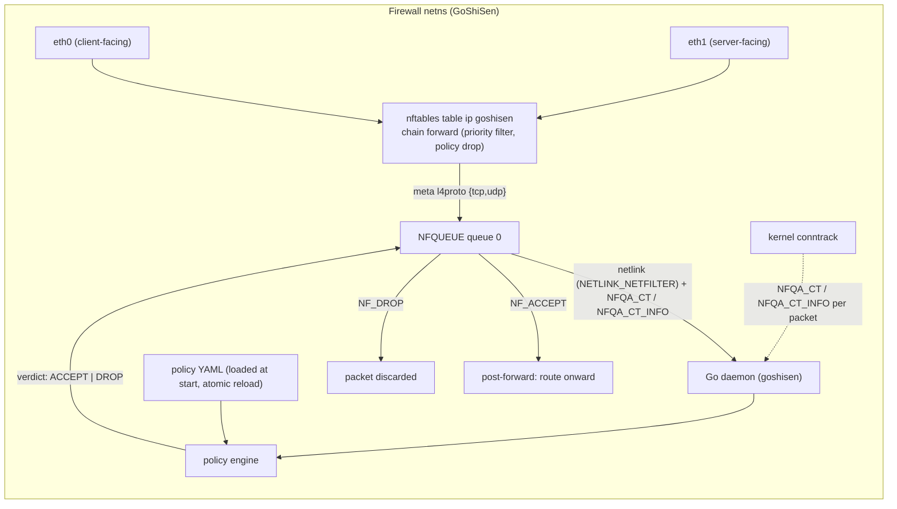
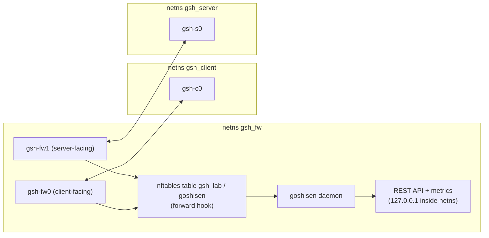

# Kiến trúc GoShiSen-Enforce

Trạng thái: **hardening/release (triển khai hiện tại).** Tài liệu này là thiết kế quy phạm cho MVP và được giữ đồng bộ với triển khai; khi thiết kế và mã khác nhau, mã là chuẩn và tài liệu này được cập nhật.

Mục tiêu: một **tường lửa phòng lab Linux** lọc **lưu lượng forwarding IPv4 TCP/UDP**. **Engine chính sách Go** đánh giá gói tin được chuyển qua **NFQUEUE**; hệ thống con **conntrack hạt nhân** sở hữu việc theo dõi kết nối; **nftables** sở hữu các hook gói tin (và NAT trong tương lai). Mọi lưu lượng IPv4 được forward không phải TCP/UDP đều bị DROP bởi chính sách mặc định của hook kernel.

---

## 1. Tổng quan hệ thống



Trình tự mỗi gói tin:

1. Một gói tin đến trong netns tường lửa trên một veth `eth` và được định tuyến sang phía kia (đường forwarding).
2. conntrack nhìn thấy nó trước (nạp `nf_defrag_ipv4`, rồi gán/cập nhật entry kết nối, giải quyết `ct state`).
3. Chain `forward` nftables (bảng `ip goshisen`, họ IPv4) khớp TCP/UDP và gửi gói tin vào NFQUEUE queue 0 (`counter queue num 0`). Chính sách chain là `drop`, nên bất cứ gì không được xếp hàng đều bị kernel DROP.
4. Daemon đọc gói tin được xếp hàng (netlink `nfnetlink_queue`), parse các header IPv4 + TCP/UDP, và đọc siêu dữ liệu conntrack của kernel gắn kèm gói tin (`NFQA_CT_INFO` bit trạng thái/hướng, `NFQA_CT` tuple/TCP-protoinfo).
5. Backend ánh xạ siêu dữ liệu đó sang trạng thái/hướng engine (`applyCTInfo`): NEW/ESTABLISHED/RELATED/INVALID và original/reply. Engine cũng theo dõi những kết nối nào chính sách đã chấp nhận (tập accepted-set `King`).
6. Engine chính sách đánh giá các quy tắc theo thứ tự (khớp đầu tiên thắng) dùng các trường thật của gói tin cộng tín hiệu trạng thái/hướng.
7. Engine ghi verdict trở lại qua cùng socket NFQUEUE: `NF_ACCEPT` hoặc `NF_DROP`.
8. Kernel tiếp tục gói tin sau hook: ACCEPT → định tuyến/xử lý sau; DROP → loại bỏ. Verdict có thẩm quyền; chain nftables không bao giờ đánh giá lại gói tin đã xếp hàng.

---

## 2. Thành phần

| Thành phần | Trách nhiệm | Vị trí |
| --- | --- | --- |
| hook nftables | FORWARD hook, bảng chỉ-IPv4, xếp hàng TCP/UDP, policy drop; chain NAT | `internal/hook` (cấp qua nhị phân `nft`; một giao dịch `nft -f` nguyên tử) |
| Vận chuyển NFQUEUE | bind queue 0, đọc gói tin, ghi verdict, gắn siêu dữ liệu CT | `internal/packet/capture.go` trên `github.com/mdlayher/netlink` (netlink Go thuần) |
| Parser gói tin | header IPv4, header TCP/UDP, options, cắt ngắn, xử lý fragment | `internal/packet/parser.go` (viết tay; không dùng gopacket) |
| Siêu dữ liệu conntrack kernel | trạng thái/hướng mỗi gói (NFQA_CT_INFO) + tuple/trạng thái TCP (NFQA_CT) | kernel; ánh xạ trong `internal/packet/capture.go` (`applyCTInfo`) — không có mirror/đăng ký sự kiện conntrack userspace |
| Engine chính sách | xác thực YAML, danh sách quy tắc, đánh giá khớp-đầu-tiên, DROP mặc định, accepted-set | `internal/policy/` |
| Runtime | nạp/nạp lại, bộ đếm health, thống kê queue, sẵn sàng, bảo đảm fail-closed | `internal/app/`, `cmd/goshisen/main.go` |

### 2.1 Ruleset nftables (dạng chuẩn)

```console
table ip goshisen {
    chain forward {
        type filter hook forward priority filter; policy drop;
        meta l4proto { tcp, udp } counter queue num 0
    }
}
```

Ghi chú thiết kế:

- **Họ `ip`** (chỉ IPv4): lưu lượng IPv6 không bao giờ tới queue; nó chạm chain policy và bị DROP. Điều này khiến việc xử lý "giao thức không hỗ trợ" trở nên tất định ở mức kernel.
- **Chain policy `drop`**: mọi thứ không phải TCP/UDP (ICMP, IGMP, GRE, ...) bị DROP mà không hỏi userspace. Điều này hiện thực DROP-mặc định cho phía *kernel*; engine hiện thực DROP-mặc định cho phía *chính sách* (xem §5.4).
- Quy tắc queue là hook duy nhất người dùng nhìn thấy. NAT tương lai sẽ thêm chain `postrouting` (masquerade) và chain `prerouting` (DNAT) trong cùng bảng — xem §8.2.
- Chẩn đoán lab (ping giữa client/server) yêu cầu quy tắc `ip protocol icmp accept` tường minh chỉ trong fixture lab; nó không thuộc chính sách sản phẩm và không phải matcher được hỗ trợ trong MVP.

---

## 3. Chi tiết luồng gói tin

### 3.1 Hook → NFQUEUE

- Chỉ dùng hook **FORWARD**. Lọc input/output (lưu lượng host-local trong ns tường lửa) nằm ngoài phạm vi.
- Một queue (0) là đủ cho MVP lab. Multiqueue/`queue-balance` là tối ưu hoá sau (ngoài phạm vi).
- Độ dài queue mặc định 1024 gói (min 0, max 65536). Daemon đặt nó lúc bind.

### 3.2 Nội dung thông điệp NFQUEUE được dùng

| Thuộc tính netlink | Công dụng |
| --- | --- |
| `NFQA_PACKET_HDR` | packet id, hook, hw ifindex |
| `NFQA_PAYLOAD` | byte gói tin thô (IPv4 từ IP header) |
| `NFQA_CT_INFO` / `NFQA_CT` | bit trạng thái/hướng conntrack kernel và tuple/TCP-protoinfo (yêu cầu qua `NFQA_CFG_F_CONNTRACK`) |
| `NFQA_CFG_*` | bind/cấu hình; `NFQA_CFG_F_GSO` **không** đặt (GSO offload ngoài phạm vi); `NFQA_CFG_F_FAIL_OPEN` **không bao giờ** đặt (fail-closed) |

### 3.3 Verdict

| Quyết định engine | Verdict NFQUEUE | Tác động kernel |
| --- | --- | --- |
| ACCEPT | `NF_ACCEPT` (1) | gói tin tiếp tục sau FORWARD hook |
| DROP | `NF_DROP` (0) | gói tin bị loại bỏ |
| (tương lai) REJECT | n/a | triển khai sau như quy tắc nftables `reject`, không qua NFQUEUE |

---

## 4. Lược đồ chính sách (YAML)

Được nạp từ một tệp chính sách duy nhất lúc khởi động; xác thực nghiêm ngặt (trường không biết là lỗi). Cú pháp được tài liệu hoá:

```yaml
version: 1                 # schema version; required
default_action: DROP       # optional; allowed: ACCEPT | DROP (default DROP)
rules:
  - id: drop-invalid
    action: DROP
    state: [INVALID]
    description: "Discard corrupted/untracked packets"

  - id: allow-established
    action: ACCEPT
    state: [ESTABLISHED, RELATED]
    description: "Reply traffic for accepted connections"

  - id: allow-dns-out
    action: ACCEPT
    protocol: udp
    dst: 10.0.0.53
    dst_port: 53
    state: [NEW]

  - id: allow-ssh
    action: ACCEPT
    protocol: tcp
    dst_port: 22
    src: 10.0.0.0/24
    state: [NEW]
```

| Trường | Kiểu | Bắt buộc | Quy tắc |
| --- | --- | --- | --- |
| `id` | string | có | duy nhất trong toàn ruleset; dùng trong log/metrics |
| `action` | string | có | `ACCEPT` \| `DROP` |
| `protocol` | string | không (mặc định `any`) | `tcp` \| `udp` \| `any` |
| `src` | string | không (mặc định `any`) | IPv4 CIDR (`a.b.c.d/n`), địa chỉ trần (host, /32), hoặc `any` |
| `dst` | string | không (mặc định `any`) | IPv4 CIDR hoặc `any`; dạng như `src` |
| `src_port` | string | không | một cổng, hoặc dải bao gồm `lo:hi`; chỉ hợp lệ với `protocol: tcp\|udp` |
| `dst_port` | string | không | giống `src_port` |
| `state` | list of string | không | `NEW`, `ESTABLISHED`, `RELATED`, `INVALID`; mặc định: mọi trạng thái. Khớp ESTABLISHED/RELATED yêu cầu kết nối đã được chấp nhận |
| `in_iface` / `out_iface` | string | — | **dành riêng**: được nhận diện nhưng bị từ chối; chưa triển khai |
| `log` | bool | không (mặc định `false`) | phát một dòng audit mỗi gói khớp |
| `description` | string | không | văn bản tự do |

Trạng thái: mọi matcher đã triển khai (`id`, `action`, `protocol`, `src`, `dst`, `src_port`, `dst_port`, `state`, `log`, `description`) đều sống trong `internal/policy`. `in_iface`/`out_iface` vẫn dành riêng và bị từ chối cho đến phase sở hữu của chúng.

### 4.1 Xác thực (cấu hình không hợp lệ)

- `version` phải là `1`; giá trị khác → lỗi khởi động.
- Trường không biết → lỗi khởi động (giải mã nghiêm ngặt, `yaml.v3` KnownFields).
- `action` ngoài `{ACCEPT, DROP}` → lỗi khởi động.
- Cổng được khai báo trong khi `protocol` không phải `tcp` hay `udp` → lỗi khởi động.
- CIDR sai định dạng (độ dài tiền tố sai 0–32, địa chỉ sai, không phải IPv4) → lỗi khởi động.
- `src_port`/`dst_port` ngoài 1–65535 hoặc dải `lo > hi` → lỗi khởi động.
- `id` trùng → lỗi khởi động.
- Giá trị `state` không hợp lệ (không phải new/established/related/invalid) → lỗi khởi động.
- `in_iface`/`out_iface` được dành riêng; chúng fail biên dịch với thông điệp có mục tiêu cho đến khi phase sở hữu của chúng đến.
- Thiếu khóa `rules` được cho phép (ruleset rỗng + `default_action` là hợp lệ: mọi thứ đều DROP).
- Daemon khởi động **chỉ sau khi** chính sách xác thực; một lần nạp lại lỗi giữ chính sách hợp lệ trước đó ở nguyên (xem §6.6).

---

## 5. Ngữ nghĩa engine

### 5.1 Thứ tự quy tắc và khớp-đầu-tiên

Quy tắc là một **danh sách phẳng, có thứ tự**. Đánh giá đi từ trên xuống; **quy tắc đầu tiên khớp sẽ quyết định** (ACCEPT hoặc DROP). Không có gộp quy tắc, không hợp nhất, không sắp xếp lại ngầm. Các quy tắc sau chỉ được chạm tới nếu không có quy tắc nào trước đó khớp.

### 5.2 DROP mặc định

Nếu không quy tắc nào khớp, verdict là `default_action` (mặc định `DROP`). Không có quy-rule-ngầm-cuối; chính sách chỉ bao giờ *thu hẹp* những gì được phép. Điều này áp dụng cho:

- giao thức L4 không được xếp hàng (chain policy drop kernel, §2.1),
- lưu lượng không có quy tắc khớp (engine DROP mặc định),
- gói tin sai định dạng/không parse được (engine DROP mặc định, §6.2),
- tràn hàng đợi / daemon-down (fail-closed, §6.5).

### 5.3 Ngữ nghĩa địa chỉ

- `src`/`dst` chỉ **địa chỉ IP thật của gói tin như nhìn tại FORWARD hook**. Khi bật NAT (§8.2): `dst` là post-DNAT (DNAT chạy trong prerouting, trước FORWARD); `src` là pre-MASQUERADE (MASQUERADE chạy trong postrouting, sau FORWARD).
- Cả hai đều là **mạng** (CIDR), không phải danh sách host. `any` ≡ `0.0.0.0/0`.
- Khớp là phép kiểm tra thuộc mạng con/tiền tố trên header IPv4 đã parse.
- Không có octet wildcard (`10.0.*.*` không hợp lệ); dùng CIDR.
- Ngữ nghĩa địa chỉ NAT được tài liệu trong §8.2; chính sách phải biểu diễn `dst`/`dst_port` theo thuật ngữ nội bộ (post-DNAT).

### 5.4 Ngữ nghĩa cổng

- `src_port`/`dst_port` khớp cổng L4 nguồn/đích của gói tin.
- Chúng chỉ hợp lệ cho `tcp`/`udp`; `protocol: any` với matcher cổng là lỗi parse.
- Cổng là dải bao gồm; một giá trị đơn là `n:n`.
- Matcher cổng không có ý nghĩa với TCP flags; khớp cổng được áp dụng cho TCP và UDP như nhau.
- Quy tắc không có giao thức lẫn cổng khớp mọi gói TCP/UDP; một khi TCP/UDP được xếp hàng, mọi gói được xếp hàng đều là TCP/UDP, nên một quy tắc `state` trần (vd `allow-established`) bao phủ cả hai.

### 5.5 Trạng thái kết nối vs hướng gói tin

Đây là các **trục khác nhau** và cả hai được tính mỗi gói, rồi đưa vào khớp quy tắc:

| Trục | Giá trị | Ý nghĩa | Nguồn |
| --- | --- | --- | --- |
| Trạng thái | `NEW` | gói đầu tiên của một kết nối (với TCP: SYN không thuộc entry hiện có; với UDP: chưa có entry) | conntrack kernel (`NFQA_CT_INFO`) |
| Trạng thái | `ESTABLISHED` | kết nối đã được theo dõi với lưu lượng cả hai hướng | conntrack kernel |
| Trạng thái | `RELATED` | gói thuộc kết nối phụ trợ của một kết nối hiện có (lỗi ICMP, FTP-data, ...) | conntrack kernel |
| Trạng thái | `INVALID` | không có trạng thái conntrack (vd fragment muộn, checksum sai, tuple không trả lời được) | conntrack kernel (thuộc tính vắng) |
| Hướng | `original` | gói đi cùng hướng với gói đã tạo entry | bit `IP_CT_IS_REPLY` của `NFQA_CT_INFO` |
| Hướng | `reply` | gói đi hướng ngược lại (tuple được nhìn đảo) | bit `IP_CT_IS_REPLY` của `NFQA_CT_INFO` |
| Được chấp nhận | `accepted` | gói khởi tạo kết nối đã được chính sách ACCEPT | accepted-set engine (`King`) |

- **Trạng thái và hướng đến từ kernel** — backend yêu cầu `NFQA_CFG_F_CONNTRACK`, khiến kernel gắn `NFQA_CT` (tuple + trạng thái protoinfo TCP) và `NFQA_CT_INFO` (trạng thái + hướng) vào mọi gói được xếp hàng. **Không tái hiện TCP conntrack trong Go.**
- Accepted-set của engine ghi nhận 5-tuple của các gói NEW-original mà chính sách đã chấp nhận. `Process` đóng dấu cờ `accepted` của gói, nên **khớp ESTABLISHED chỉ thành công nếu kết nối được chấp nhận** — riêng five-tuple không bao giờ là bằng chứng một kết nối TCP đã established (chống reply-smuggling).
- Mẫu khuyến nghị là `allow-established` (`state: [ESTABLISHED, RELATED]`, `action: ACCEPT`); `NEW` phải được cho phép theo từng dịch vụ.
- Trạng thái bắt tay TCP đến qua `CTA_PROTOINFO_TCP_STATE` (SYN_SENT ... ESTABLISHED ... CLOSE). Engine không gating chúng độc lập với phân loại NEW/ESTABLISHED của conntrack.
- **Giới hạn ICMP RELATED:** hook chỉ xếp hàng TCP/UDP (`meta l4proto { tcp, udp }`); gói lỗi ICMP bị DROP bởi chain policy trước userspace. Do đó **lưu lượng RELATED lỗi-ICMP không quan sát được bởi engine** — `RELATED` trên thực tế chỉ bao phủ các luồng phụ trợ được xếp hàng. Đây là giới hạn được tài liệu hoá của MVP (yêu cầu: IPv4 TCP/UDP).

### 5.6 Thứ tự đánh giá (mỗi gói)

1. Parse header IPv4; từ chối không-IPv4/cắt ngắn (→ DROP mặc định).
2. Đọc các thuộc tính `NFQA_CT_INFO` (trạng thái/hướng) và `NFQA_CT` (tuple/TCP protoinfo) của kernel; ánh xạ sang trạng thái/hướng engine. Không theo dõi (không thuộc tính CT) → INVALID (một gói NEW hướng-original không thuộc tính được để không trạng thái để quy tắc không trạng thái vẫn có thể chấp nhận nó).
3. Với mỗi quy tắc, kiểm tra protocol, tiền tố src/dst, cổng, tập trạng thái, theo thứ tự; khớp đầy đủ đầu tiên cho verdict.
4. Không khớp → `default_action`.
5. Nếu verdict là ACCEPT và trạng thái là NEW, đánh dấu kết nối `accepted` (accepted-set `King`). DROP không bao giờ thay đổi `accepted`.

---

## 6. Hành vi lỗi và trường hợp biên

### 6.1 Cấu hình không hợp lệ
Xem §4.1. Lỗi nạp chính sách hủy bỏ khởi động hoặc giữ chính sách trước khi nạp lại; daemon không bao giờ chạy với chính sách áp dụng một phần.

### 6.2 Fragment
- Vì conntrack được bật cho bảng, kernel nạp `nf_defrag_ipv4`; fragment được **tái ghép trước** khi tra cứu conntrack và trước FORWARD hook. Queue do đó bình thường thấy gói hoàn chỉnh.
- Phòng thủ theo chiều sâu: parser vẫn xử lý đầu vào có thể fragment/sai định dạng mà không panic — header cắt ngắn, thiếu header L4, payload độ dài không, độ dài không hợp lệ → DROP mặc định.
- Nếu một fragment bao giờ tới engine (vd defrag không khả dụng), fragment không-đầu tiên bị DROP (không có header L4 để khớp); fragment đầu tiên với header L4 hoàn chỉnh được đánh giá bình thường.

### 6.3 Giao thức không hỗ trợ
- IPv6: không bao giờ được xếp hàng (bảng chỉ-IPv4) → kernel policy drop.
- IPv4 không-TCP/UDP (ICMP, IGMP, GRE, ESP, ...): không bao giờ được xếp hàng → kernel policy drop.
- TCP/UDP với header không parse được: DROP mặc định (§6.2).

### 6.4 Tràn hàng đợi
- Kernel DROP các gói khi queue 0 đầy (maxlen, mặc định 1024) và chưa có verdict; các gói này **không** được xếp hàng lại. Vì chain policy là `drop`, tràn nhất quán với DROP mặc định (không bypass). Backend không bao giờ đặt `NFQA_CFG_F_FAIL_OPEN` — tràn không bao giờ có thể ACCEPT một gói.
- Daemon lấy mẫu thống kê per-queue của kernel (`/proc/net/netfilter/nfnetlink_queue`; `queue_dropped` = DROP do queue đầy, `queue_user_dropped` = lỗi unicast) mỗi giây một lần, ghi nhận `goshisen_queue_overflow_total{cause="kernel_drop"|"user_drop"}`, và ghi cảnh báo giới hạn tần suất. Tràn là tín hiệu để tăng `queue_maxlen` hoặc tăng tốc verdict, không phải vấn đề đúng đắn.

### 6.5 Crash tiến trình và fail-closed
- Nếu daemon chết, queue bị unbind; quy tắc nftables khiến kernel DROP lưu lượng (không có nguồn verdict). Đây là **fail-closed**: tường lửa crash dừng lưu lượng thay vì cho qua.
- Daemon khởi động lại dưới supervisor (unit systemd — `deployments/systemd/goshisen.service` — hoặc vòng lặp khởi động lại `scripts/supervisor.sh` của lab). Khi khởi động lại nó cài lại hook (nguyên tử) và bind lại queue 0; chính sách được khôi phục từ kho bền vững / tệp chính sách. Không có trạng thái kết nối userspace nào sống sót qua khởi động lại; các entry conntrack của kernel vẫn có thẩm quyền (chúng KHÔNG bị xoá bởi khởi động lại daemon) và các kết nối `NEW` được chính sách chấp nhận lại.
- Sẵn sàng: `GET /readyz` chỉ trả 200 sau khi hook được cài VÀ queue được bind; nó là 503 trong lúc khởi động, trên mọi lỗi khởi động, và từ lúc bắt đầu tắt máy. Hook được đặt trước khi queue bind, nên tường lửa fail closed suốt quá trình khởi động.

### 6.6 Nạp lại chính sách
- Kích hoạt nạp lại: `SIGHUP` (daemon nạp lại tệp chính sách) và các endpoint apply/activate có phiên bản của REST API (nguyên tử, CAS-guarded).
- Chính sách mới được parse và xác thực đầy đủ **trước khi** chuyển; khi có lỗi bất kỳ, chính sách cũ vẫn hoạt động và lần nạp lại được log/từ chối.
- Một publish tuân theo thứ tự nghiêm ngặt, nên chính sách không bao giờ được áp dụng nửa chừng:
  1. tuần tự hoá với khóa thay đổi chính sách toàn-tiến-trình (một `sync.Mutex` chia sẻ giữa đường SIGHUP của daemon và REST API),
  2. biên dịch/xác thực chính sách mới, rồi tính phiên bản kế tiếp từ kho bền vững,
  3. ghi tệp chính sách rồi con trỏ active (cả hai được fsync; hoặc cả hai đổ xuống hoặc không cái nào),
  4. chỉ sau khi kho bền vững, mới hoán đổi snapshot trong bộ nhớ (`King.Replace`) và ghi nhận metric thành công.
  Mọi lỗi trước bước 4 để cả kho bền vững lẫn ruleset sống trên chính sách trước. Nếu daemon chết giữa publish (sau khi ghi, trước khi kích hoạt), phục hồi khởi động lại đọc con trỏ *active*, nên phiên bản rách không bao giờ kích hoạt.
- Chuyển là nguyên tử: engine hoán đổi một con trỏ bất biến tới danh sách quy tắc đã biên dịch. Gói đang bay được đánh giá với snapshot chúng bắt đầu; gói mới thấy danh sách mới.
- Accepted-set `King` **không** bị xoá khi nạp lại (kết nối được chấp nhận sống sót qua hoán đổi chính sách).
- Một lần nạp lại thay đổi cổng/địa chỉ chỉ ảnh hưởng quyết định mới; kết nối đã chấp nhận tiếp tục dưới quy tắc ESTABLISHED/RELATED cho đến khi hết hạn (timeout/sự kiện kernel).
- Quan sát kết quả: `goshisen_policy_updates_total{outcome="success"|"failure"|"conflict"}` ghi nhận mọi lần thử publish; `goshisen_active_policy_version` theo dõi phiên bản active. Nạp lại SIGHUP được log kèm nguồn (`sighup`) và phiên bản.

---

## 7. Môi trường lab (network namespace cô lập)

### 7.1 Cấu trúc liên kết



- Ba namespace: `gsh_fw` (tường lửa + daemon), `gsh_client`, `gsh_server`. Script lab (`scripts/lab.sh`) tạo chúng với các cặp veth tiền tố `gsh_` và quy tắc forward-hook chỉ trong namespace router.
- Tường lửa forward giữa `client` và `server` chỉ vậy. Lưu lượng host không bao giờ vào FORWARD hook.
- API/metrics bind loopback bên trong `gsh_fw`; truy cập chúng từ host qua `ip netns exec gsh_fw ...`.

### 7.2 Thiết lập/dọn dẹp đáng tin

- `scripts/lab.sh` (đã triển khai) với `set -euo pipefail` và **tiền tố tài nguyên duy nhất** (namespace `gsh_`, veth `gsh-fw*`): `up` tạo, `down` dọn, `status` kiểm tra. Chỉ chạy với root; từ chối kèm thông điệp rõ ràng nếu không.
- Chỉ namespace router `gsh_fw` bao giờ nhận quy tắc nftables (bảng hook `ip goshisen`); tường lửa máy chủ không bao giờ được liệt kê, flush, hoặc sửa.
- Daemon được khởi động bên trong `gsh_fw` (`ip netns exec gsh_fw goshisen --config ...`), nên hook được tạo trong namespace đó lúc khởi động; teardown namespace gỡ mọi trạng thái tường lửa cùng với nó.
- Hỗ trợ xác minh: bộ tích hợp dùng `tests/integration/probe` (một Go binary nhỏ: listener TCP/UDP và probe connect), nên không cần `nc`/`socat`.

---

## 8. Thư viện và rủi ro tương thích

| Thư viện | Mục đích | Trạng thái / ghi chú |
| --- | --- | --- |
| `github.com/mdlayher/netlink` | netlink mức thấp; phụ thuộc ngoài duy nhất của backend NFQUEUE | ghim v1.11.2; Go thuần |
| `gopkg.in/yaml.v3` | parse chính sách/cấu hình (giải mã nghiêm ngặt) | ổn định; `KnownFields(true)` cho tính nghiêm ngặt |
| — (parser viết tay) | parse header IPv4/TCP/UDP | không phụ thuộc; ~170 LOC; unit-tested gồm fuzz (`FuzzParse`); chọn thay gopacket (phụ thuộc nặng, bề mặt lớn hơn) |
| nhị phân `nft` | cấp ruleset nftables (cài/xác minh/dọn hook) | `internal/hook`; một giao dịch `nft -f` nguyên tử mỗi lần cài; không có thư viện nftables Go |
| module kernel | `nf_tables`, `nfnetlink_queue`, `nf_conntrack`, `nf_defrag_ipv4` | yêu cầu lúc runtime; vắng mặt hiện thành lỗi khởi động rõ ràng (khởi tạo cache `nft` / lỗi dial netlink) |

Sàn kernel/Go: Linux ≥ 5.6 (ngữ nghĩa queue per-netns nf_tables), Go ≥ 1.25 (bắt buộc bởi phiên bản thư viện netlink đã ghim; go.mod ghim 1.25.0). Máy chủ lab phải chạy kernel có thể nạp các module này (hoặc built-in). Không có phụ thuộc cgo lúc build.

### 8.1 Checklist phụ thuộc cho chấp nhận
- `go build ./...` thành công từ clean checkout (không cgo).
- Ghim phiên bản trong go.mod là tường minh; `go mod verify` PASS.
- Daemon từ chối khởi động với thông điệp rõ ràng nếu thiếu module kernel bất kỳ (probe lúc khởi động).

### 8.2 NAT (đã triển khai)

NAT được triển khai **hoàn toàn trong kernel** qua các chain nftables trong bảng do ứng dụng sở hữu `ip goshisen` — địa chỉ/checksum không bao giờ được viết lại trong Go:

| Chain | Hook | Mục đích |
| --- | --- | --- |
| `dstnat` | prerouting | DNAT (`dnat to`), quy tắc có thứ tự, khớp protocol/addr/port |
| `srcnat` | postrouting | MASQUERADE (`oifname ... masquerade`) |

**Điều đánh giá chính sách thấy (theo từng hook):**

- **DNAT (prerouting) chạy trước FORWARD.** Engine thấy **đích post-DNAT** (nội bộ `target_ip:target_port`). Chính sách phải biểu diễn `dst`/`dst_port` theo thuật ngữ nội bộ; quy tắc khớp IP công khai sẽ không bao giờ khớp. Test tích hợp `TestNATWithFiltering` chứng minh đúng điều này.
- **MASQUERADE (postrouting) chạy sau FORWARD.** Engine thấy **nguồn pre-MASQUERADE** (địa chỉ thật của client), không bao giờ là địa chỉ egress đã viết lại. Test tích hợp `TestNATMasquerade` chứng minh server thấy nguồn đã masquerade.
- Lưu lượng trả về: conntrack bỏ NAT các reply; chính sách `ESTABLISHED`/`RELATED` xử lý chúng bình thường.
- **Không bao giờ flush ngoài phạm vi ứng dụng:** ruleset là một giao dịch `nft -f` trên bảng do ứng dụng sở hữu chỉ vậy (`add table` + `delete table` + định nghĩa lại đầy đủ — nguyên tử; một lần áp dụng lỗi không thay đổi gì). `hook.Cleanup` chỉ xoá `table ip goshisen`; nó được phơi cho operator như `goshisen hook cleanup` (cần root). Bản thân daemon không bao giờ flush bảng nào.

---

## 9. Tổng quan các phase

Các phase triển khai (tiêu chí chấp nhận đầy đủ trong `mvp-scope.md` §5):

| Phase | Trạng thái | Bàn giao |
| --- | --- | --- |
| 1 | **done** | Nền móng dự án: module Go, CLI (`--help`/`--version`/`--config`), thứ tự ưu tiên cấu hình, ghi log có cấu trúc, tín hiệu, đóng máy mượt, lệnh xác thực, Makefile gate, CI |
| 2 | **done** | Engine chính sách: biên dịch YAML (nghiêm ngặt), bất biến snapshot + thay thế nguyên tử, đánh giá khớp-đầu-tiên, DROP mặc định, lệnh offline `policy validate` / `policy simulate` |
| 3 | **done** | Thực thi gói tin thật: backend NFQUEUE trực tiếp (netlink), parser IPv4 TCP/UDP không-panic, hook nftables (`internal/hook`), lab netns (`scripts/lab.sh`), bộ tích hợp (gated bằng root), test fuzz |
| 4 | **done** | Lọc có trạng thái: siêu dữ liệu CONNTRACK từ kernel (`NFQA_CT`/`NFQA_CT_INFO`), matcher `state`, ngữ nghĩa hướng + accepted-set, nạp lại SIGHUP, test tích hợp trạng thái; giới hạn ICMP RELATED được tài liệu hoá |
| 5 | **done** | REST API + metrics: API bind localhost với bearer auth và version CAS, kho chính sách phiên bản bền vững với phục hồi khởi động lại, log audit, metrics Prometheus bản số giới hạn, liveness/readiness |
| 6 | **done** | NAT + đóng gói: DNAT/MASQUERADE kernel trong bảng do ứng dụng sở hữu (giao dịch `nft -f` nguyên tử, docs rollback), ngữ nghĩa pre/post-NAT được tài liệu hoá, test tích hợp NAT, Dockerfile nhiều giai đoạn (không chế độ đặc quyền) |
| 7 | in progress | Củng cố & phát hành: giám sát tràn hàng đợi + bộ đếm, củng cố crash/restart + gating sẵn sàng, ví dụ supervisor (systemd/vòng lab), ghim phụ thuộc, đóng tài liệu, chạy chấp nhận cuối |
| 8–13 | done (lịch sử repo) | Đóng gói OpenWrt + vòng đời procd, thực thi IPv6 (hook inet), tái lập build phát hành (kho lưu trữ tĩnh, SBOM, checksums), phát hiện/cảnh báo flow-offload — bằng chứng trong `docs/release/` |
| 14 | done | Chính sách flow-offload (`offload_policy`: `warn`/`refuse`/`readiness`) — kiểm soát tùy chọn không-im-lặng của khoảng trống thực thi luồng-established (Issue #6) |
| 15 | done | Công bố chính sách nguyên tử: pipeline publish SIGHUP/API thống nhất (biên dịch → kho bền vững → hoán đổi king dưới một khóa), metric kết quả, bản xem trước `policy dry-run`, phục hồi fail-closed giữa publish |
| 16 | done | Hiệu năng: khóa accepted-set không-cấp-phát (struct 5-tuple đóng gói, không `fmt`/string), `Rule` gọn (bitmask trạng thái, cổng giá trị), metric gói không-cấp-phát khóa đơn (mảng index-enum cố định), buffer verdict gộp, parse thuộc tính inline; bộ benchmark + bằng chứng baseline/profile/optimize trong `docs/design/performance.md` (−70–99% trên đường stateful/pipeline, −82% p95/p99, 0 allocs/gói) |
| 17 | done | Phát hiện + tắt offload: state machine (disabled/enabled/failed/unknown), `offload_policy=enforce` tắt fail-closed (đã xác minh), CLI `offload status/disable`, cửa sổ chẩn đoán `allow_bypass`, metrics (`goshisen_flow_offload_state`, bộ đếm kết quả tắt) — `docs/design/offload-disable.md` |
| 18 | done | Quan sát bypass flowtable: `offload observe` đo chỉ-đọc (timestamp/state/bộ đếm hit per-flowtable/confidence), metrics `goshisen_flowtable_hits_packets` + `_available`, xử lý reset/tràn bộ đếm, mô hình trạng thái absent/zero-hit/positive/unknown — `docs/design/offload-observability.md` |

Khóa cấu hình hiện được nhận diện: `interface`, `policy_file`, `log_level`, `log_json`, `api_host`, `api_port`, `api_token`, `metrics_port`, `policy_dir`, `queue_maxlen`, `offload_policy`, `allow_bypass`, `hook_scope`, `nat` (xem `internal/config`). Lược đồ chính sách YAML trong §4 là một định dạng tệp riêng, được triển khai bởi `internal/policy` và nối vào đường gói tin.

## 10. Câu hỏi mở (được theo dõi, không chặn)
- Liệu đăng ký `ct_event` conntrack của kernel (hoặc dump định kỳ `/proc/net/nf_conntrack`) có cần cho "hết hạn accepted-set" hay metrics trong một phase sau; hiện accepted-set tăng cho đến khi khởi động lại daemon (giới hạn theo kết nối, chấp nhận được cho lab).
- Độ dài queue mặc định (1024) có thể cần chỉnh cho thông lượng lab; các bộ đếm tràn (`goshisen_queue_overflow_total`) sẽ cho biết.
