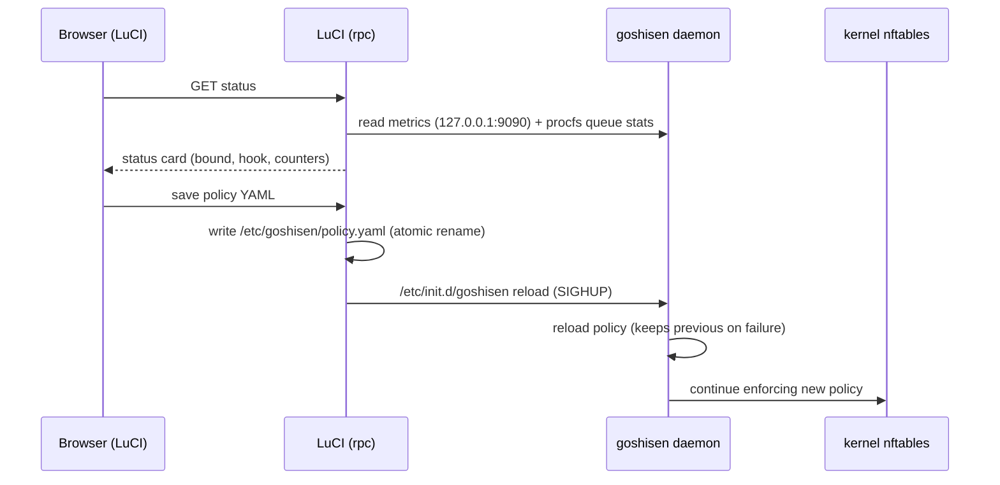

# Đề xuất Kiến trúc LuCI (dự thảo)

Ngày: 2026-11-11. Trạng thái: chỉ là đề xuất — chưa có mã LuCI nào tồn tại
trong kho lưu trữ này (các quy ước UI OpenWrt nằm trong feed `luci`).

## Mục tiêu

Phơi bày trạng thái chính sách và khả năng điều khiển của GoShiSen-Enforce trong
web UI LuCI của OpenWrt: một trang trạng thái chỉ đọc cộng với một trình soạn chính sách ghi
cùng YAML mà daemon reload qua SIGHUP. Daemon không bao giờ giao tiếp trực tiếp với
LuCI; cả hai chia sẻ `/etc/goshisen/policy.yaml` và cấu hình UCI
(`/etc/config/goshisen`).

## Ranh giới

- Lưu lượng quản lý nằm ngoài phạm vi queue do cấu trúc: hook
  chỉ là `filter forward`, nên lưu lượng LuCI (đích đến bản thân router, đường input)
  không bao giờ bị thực thi. Kiểm thử e2e NFQUEUE đã xác nhận
  bảng điều khiển quản lý vẫn luôn tiếp cận được qua các đường độc lập.
- Các HTTP server API/metrics chỉ bind vào `127.0.0.1`; LuCI chạy trên
  chính router, nên có thể đọc chúng trực tiếp. Không có phơi bày mạng mới.

## Các module LuCI đề xuất

| Module | Loại | Nền tảng |
| --- | --- | --- |
| `luci.controller.goshisen` | controller | đọc `/etc/config/goshisen` qua `uci`, ghi policy qua ghi tệp |
| `luci.model.cbi.goshisen` | CBI map | UCI `goshisen.main` (queue_num, hook_scope, log_level, interface, ports) |
| `luci.view.goshisen/status.htm` | view | trạng thái daemon: process còn sống, queue đã bind (`/proc/net/netfilter/nfnetlink_queue`), hook đã cài (`nft list chain ip goshisen forward`), phiên bản policy, các bộ đếm verdict hiện tại qua `http://127.0.0.1:9090/metrics` |
| `luci.view.goshisen/policy.htm` | view | textarea YAML được hỗ trợ bởi `/etc/goshisen/policy.yaml` + nút "Reload" (`/etc/init.d/goshisen reload`) |

## Luồng

## Các cân nhắc bảo mật

- Trình soạn chính sách là nơi duy nhất có thể làm suy yếu việc thực thi; nó
  phải được chặn cho admin (nhóm `admin` của LuCI) và phải hiển thị
  banner mặc định fail-closed.
- Thứ tự ghi nguyên tử + reload: ghi vào `policy.yaml.tmp`, fsync,
  rename đè lên `policy.yaml`, rồi reload. Đường SIGHUP của daemon
  đã biên dịch trước khi thay thế snapshot đang hoạt động, nên một tệp lỗi
  sẽ giữ lại chính sách trước đó.
- Xác thực: tái sử dụng `policy validate` của daemon khi lưu (hoặc
  hook `validate` của CBI) để lỗi cú pháp bị bắt trước khi reload.

## Ngoài phạm vi

- Thêm LuCI vào `DEPENDS` của gói (UI là tùy chọn).
- Một trình xem/sniffer gói thời gian thực.
- Quản lý đội router nhiều máy.
