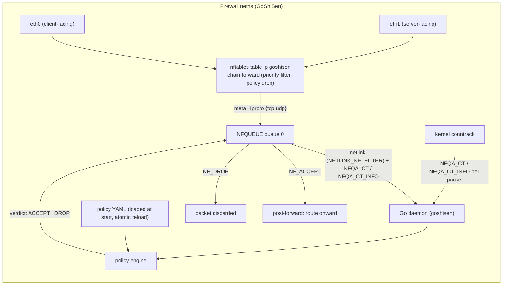
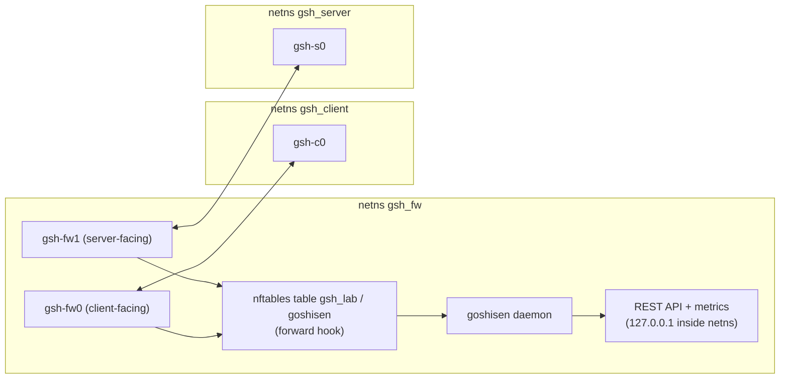

# GoShiSen-Enforce Architecture

Status: **Phase 7 — hardening/release (implementation current).** This document is the normative design for the MVP and is kept in sync with the implementation; where the design and code differ, the code wins and this document is updated.

Target: a **Linux lab firewall** filtering **IPv4 TCP/UDP forwarding** traffic. A **Go policy engine** evaluates packets delivered via **NFQUEUE**; the **kernel conntrack** subsystem owns connection tracking; **nftables** owns packet hooks (and future NAT). All non-TCP/UDP IPv4 forwarded traffic is dropped by the kernel hook's default policy.

---

## 1. System overview



Sequence per packet:

1. A packet arrives in the firewall netns on an `eth` veth and is destined for the other side (forwarding path).
2. conntrack sees it first (loads `nf_defrag_ipv4`, then assigns/updates the connection entry, resolving `ct state`).
3. The nftables `forward` chain (table `ip goshisen`, family IPv4) matches TCP/UDP and sends the packet to NFQUEUE queue 0 (`counter queue num 0`). The chain policy is `drop`, so anything not queued is dropped by the kernel.
4. The daemon reads the queued packet (netlink `nfnetlink_queue`), parses the IPv4 + TCP/UDP headers, and reads the kernel's conntrack metadata attached to the packet (`NFQA_CT_INFO` state/direction bits, `NFQA_CT` tuple/TCP-protoinfo).
5. The backend maps that metadata to engine state/direction (`applyCTInfo`): NEW/ESTABLISHED/RELATED/INVALID and original/reply. The engine also tracks which connections the policy accepted (the `King` accepted-set).
6. The policy engine evaluates rules in order (first match wins) using the packet's real fields plus state/direction signals.
7. The engine writes the verdict back through the same NFQUEUE socket: `NF_ACCEPT` or `NF_DROP`.
8. The kernel resumes the packet after the hook: ACCEPT → routing/post-processing; DROP → discard. The verdict is authoritative; the nftables chain never re-evaluates the queued packet.

---

## 2. Components

| Component | Responsibility | Location |
| --- | --- | --- |
| nftables hook | FORWARD hook, IPv4-only table, queue TCP/UDP, policy drop; NAT chains (Phase 6) | `internal/hook` (provisioned via the `nft` binary; one atomic `nft -f` transaction) |
| NFQUEUE transport | bind queue 0, read packets, write verdicts, attach CT metadata | `internal/packet/capture.go` over `github.com/mdlayher/netlink` (pure Go netlink) |
| Packet parser | IPv4 header, TCP/UDP headers, options, truncation, fragment handling | `internal/packet/parser.go` (hand-rolled; no gopacket) |
| Kernel conntrack metadata | per-packet state/direction (NFQA_CT_INFO) + tuple/TCP state (NFQA_CT) | kernel; mapped in `internal/packet/capture.go` (`applyCTInfo`) — no userspace conntrack mirror/event subscription |
| Policy engine | YAML validation, rule list, first-match evaluation, default DROP, accepted-set | `internal/policy/` |
| Runtime | load/reload, health counters, queue stats, readiness, fail-closed guarantee | `internal/app/`, `cmd/goshisen/main.go` |

### 2.1 nftables ruleset (canonical form)

```console
table ip goshisen {
    chain forward {
        type filter hook forward priority filter; policy drop;
        meta l4proto { tcp, udp } counter queue num 0
    }
}
```

Design notes:

- **Family `ip`** (IPv4 only): IPv6 traffic never reaches the queue; it hits the chain policy and is dropped. This makes "unsupported protocol" handling deterministic at the kernel level.
- **Chain policy `drop`**: everything that is not TCP/UDP (ICMP, IGMP, GRE, …) is dropped without consulting userspace. This realizes default-DROP for the *kernel* side; the engine implements default-DROP for the *policy* side (see §5.4).
- The queue rule is the only user-visible hook. Future NAT will add a `postrouting` chain (masquerade) and a `prerouting` chain (DNAT) in the same table — see §8.2.
- Lab diagnostics (ping between client/server) require an explicit `ip protocol icmp accept` rule in the lab fixture only; it is not part of the product policy and is not a supported matcher in the MVP.

---

## 3. Packet flow details

### 3.1 Hook → NFQUEUE

- Only the **FORWARD** hook is used. Input/output filtering (host-local traffic in the firewall ns) is out of scope.
- One queue (0) is sufficient for the lab MVP. Multiqueue/`queue-balance` is a later optimization (out of scope).
- Default queue maxlen 1024 packets (min 0, max 65536). The daemon sets it at bind time.

### 3.2 NFQUEUE message contents used

| Netlink attribute | Use |
| --- | --- |
| `NFQA_PACKET_HDR` | packet id, hook, hw ifindex |
| `NFQA_PAYLOAD` | raw packet bytes (IPv4 from IP header) |
| `NFQA_CT_INFO` / `NFQA_CT` | kernel conntrack state/direction bits and tuple/TCP-protoinfo (requested via `NFQA_CFG_F_CONNTRACK`) |
| `NFQA_CFG_*` | bind/config; `NFQA_CFG_F_GSO` is **not** set (GSO offload out of scope); `NFQA_CFG_F_FAIL_OPEN` is **never** set (fail-closed) |

### 3.3 Verdicts

| Engine decision | NFQUEUE verdict | Kernel effect |
| --- | --- | --- |
| ACCEPT | `NF_ACCEPT` (1) | packet continues after the FORWARD hook |
| DROP | `NF_DROP` (0) | packet discarded |
| (future) REJECT | n/a | implemented later as an nftables `reject` rule, not through NFQUEUE |

---

## 4. Policy schema (YAML)

Loaded from a single policy file at startup; validated strictly (unknown fields are errors). Documented syntax:

```yaml
version: 1                 # schema version; required
default_action: DROP       # optional; allowed: ACCEPT | DROP (default DROP)
rules:
  - id: drop-invalid
    action: DROP
    state: [INVALID]
    description: "Discard corrupted/untracked packets"

  - id: allow-established
    action: ACCEPT
    state: [ESTABLISHED, RELATED]
    description: "Reply traffic for accepted connections"

  - id: allow-dns-out
    action: ACCEPT
    protocol: udp
    dst: 10.0.0.53
    dst_port: 53
    state: [NEW]

  - id: allow-ssh
    action: ACCEPT
    protocol: tcp
    dst_port: 22
    src: 10.0.0.0/24
    state: [NEW]
```

| Field | Type | Required | Rules |
| --- | --- | --- | --- |
| `id` | string | yes | unique across the ruleset; used in logs/metrics |
| `action` | string | yes | `ACCEPT` \| `DROP` |
| `protocol` | string | no (default `any`) | `tcp` \| `udp` \| `any` |
| `src` | string | no (default `any`) | IPv4 CIDR (`a.b.c.d/n`), bare address (host, /32), or `any` |
| `dst` | string | no (default `any`) | IPv4 CIDR or `any`; same forms as `src` |
| `src_port` | string | no | single port, or inclusive range `lo:hi`; only valid with `protocol: tcp\|udp` |
| `dst_port` | string | no | same as `src_port` |
| `state` | list of string | no | `NEW`, `ESTABLISHED`, `RELATED`, `INVALID`; default: all states. ESTABLISHED/RELATED matches require the connection to have been accepted |
| `in_iface` / `out_iface` | string | — | **reserved**: recognized but rejected; not yet implemented |
| `log` | bool | no (default `false`) | emit one audit line per matched packet |
| `description` | string | no | free text |

Status: all implemented matchers (`id`, `action`, `protocol`, `src`, `dst`, `src_port`, `dst_port`, `state`, `log`, `description`) are live in `internal/policy`. `in_iface`/`out_iface` remain reserved and rejected until their owning phase.

### 4.1 Validation (invalid configuration)

- `version` must be `1`; anything else → startup failure.
- Unknown fields → startup failure (strict decoding, `yaml.v3` KnownFields).
- `action` outside `{ACCEPT, DROP}` → startup failure.
- Ports given while `protocol` is neither `tcp` nor `udp` → startup failure.
- Malformed CIDR (bad prefix length 0–32, bad address, non-IPv4) → startup failure.
- `src_port`/`dst_port` outside 1–65535 or range `lo > hi` → startup failure.
- Duplicate `id` → startup failure.
- Invalid `state` values (not new/established/related/invalid) → startup failure.
- `in_iface`/`out_iface` are reserved; they fail compilation with a targeted message until their owning phase lands.
- Missing `rules` key is allowed (an empty ruleset + `default_action` is valid: everything drops).
- The daemon starts **only after** the policy validates; a failed reload keeps the previous valid policy in place (see §6.6).

---

## 5. Engine semantics

### 5.1 Rule ordering and first-match

Rules are a **flat, ordered list**. Evaluation walks top to bottom; the **first rule that matches decides** (ACCEPT or DROP). There is no rule aggregation, no merging, no implicit reordering. Later rules are reached only if no earlier rule matched.

### 5.2 Default DROP

If no rule matches, the verdict is the `default_action` (default `DROP`). There is no implicit last-rule; the policy only ever *narrows* what is allowed. This holds for:

- unqueued L4 protocols (kernel chain policy drop, §2.1),
- traffic with no matching rule (engine default DROP),
- malformed/unparseable packets (engine default DROP, §6.2),
- queue overflow / daemon-down conditions (fail-closed, §6.5).

### 5.3 Address semantics

- `src`/`dst` refer to the **packet's actual IP addresses as seen at the FORWARD hook**. With NAT enabled (§8.2): `dst` is post-DNAT (DNAT runs in prerouting, before FORWARD); `src` is pre-MASQUERADE (MASQUERADE runs in postrouting, after FORWARD).
- Both are **networks** (CIDR), not host lists. `any` ≡ `0.0.0.0/0`.
- Matching is a prefix/subnet membership test on the parsed IPv4 header.
- There are no wildcard octets (`10.0.*.*` is invalid); use CIDR.
- NAT address semantics are documented in §8.2; policy must express `dst`/`dst_port` in internal (post-DNAT) terms.

### 5.4 Port semantics

- `src_port`/`dst_port` match the packet's L4 source/destination ports.
- They are only valid for `tcp`/`udp`; `protocol: any` with a port matcher is a parse error.
- Ports are inclusive ranges; a single value is `n:n`.
- Port matchers have no meaning for the TCP flags; port matching is applied to TCP and UDP alike.
- A rule with neither protocol nor ports matches any TCP/UDP packet; once TCP/UDP is queued, all queued packets are TCP/UDP, so a bare `state` rule (e.g. `allow-established`) covers both.

### 5.5 Connection state vs packet direction

These are **different axes** and are both computed per packet, then fed to rule matching:

| Axis | Values | Meaning | Source |
| --- | --- | --- | --- |
| State | `NEW` | first packet of a connection (for TCP: SYN not part of an existing entry; for UDP: no entry yet) | kernel conntrack (`NFQA_CT_INFO`) |
| State | `ESTABLISHED` | connection already tracked with traffic in both directions | kernel conntrack |
| State | `RELATED` | packet belongs to an auxiliary connection of an existing one (ICMP errors, FTP-data, …) | kernel conntrack |
| State | `INVALID` | no conntrack state (e.g. late fragment, bad checksum, unanswerable tuple) | kernel conntrack (absent attrs) |
| Direction | `original` | packet travels the same way as the packet that created the entry | `NFQA_CT_INFO` `IP_CT_IS_REPLY` bit |
| Direction | `reply` | packet travels the opposite way (the tuple is seen reversed) | `NFQA_CT_INFO` `IP_CT_IS_REPLY` bit |
| Accepted | `accepted` | the connection's initiating packet was ACCEPTed by policy | engine's accepted-set (`King`) |

- **State and direction come from the kernel** — the backend requests `NFQA_CFG_F_CONNTRACK`, which makes the kernel attach `NFQA_CT` (tuple + TCP protoinfo state) and `NFQA_CT_INFO` (state + direction) to every queued packet. **No TCP conntrack is reimplemented in Go.**
- The engine's accepted-set records 5-tuples of NEW-original packets the policy accepted. `Process` stamps the packet's `accepted` flag, so **an ESTABLISHED match succeeds only if the connection was accepted** — the five-tuple alone is never proof that a TCP connection is established (prevents reply-smuggling).
- The recommended pattern is `allow-established` (`state: [ESTABLISHED, RELATED]`, `action: ACCEPT`); `NEW` must be allowed per service.
- TCP handshake states arrive via `CTA_PROTOINFO_TCP_STATE` (SYN_SENT … ESTABLISHED … CLOSE). The engine does not gate on them independently of conntrack's NEW/ESTABLISHED classification.
- **ICMP RELATED limitation:** the hook only queues TCP/UDP (`meta l4proto { tcp, udp }`); ICMP error packets are dropped by the chain policy before userspace. Consequently **ICMP-error RELATED traffic is not observable by the engine** — `RELATED` in practice only covers queued auxiliary flows. This is a documented limitation of the MVP (requirements: IPv4 TCP/UDP).

### 5.6 Evaluation order (per packet)

1. Parse IPv4 header; reject non-IPv4/truncated (→ default DROP).
2. Read the kernel's `NFQA_CT_INFO` (state/direction) and `NFQA_CT` (tuple/TCP protoinfo) attributes; map to engine state/direction. Untracked (no CT attrs) → INVALID (a NEW original-direction packet with no attrs is left stateless so stateless rules can still accept it).
3. For each rule, test protocol, src/dst prefix, ports, state set, in order; first full match yields the verdict.
4. No match → `default_action`.
5. If verdict is ACCEPT and state is NEW, mark the connection `accepted` (the `King` accepted-set). DROP never alters `accepted`.

---

## 6. Failure and edge-case behavior

### 6.1 Invalid configuration
See §4.1. Policy load failures abort startup or keep the previous policy on reload; the daemon never runs with a partially applied policy.

### 6.2 Fragments
- Because conntrack is enabled for the table, the kernel loads `nf_defrag_ipv4`; fragments are **reassembled before** the conntrack lookup and before the FORWARD hook. The queue therefore normally sees whole packets.
- Defense in depth: the parser still handles fragmentable/malformed input without panicking — truncated headers, missing L4 header, zero-length payload, invalid lengths → default DROP.
- If a fragment ever reaches the engine (e.g. defrag unavailable), non-initial fragments are DROPped (no L4 header to match); an initial fragment with a complete L4 header is evaluated normally.

### 6.3 Unsupported protocols
- IPv6: never queued (IPv4-only table) → kernel policy drop.
- Non-TCP/UDP IPv4 (ICMP, IGMP, GRE, ESP, …): never queued → kernel policy drop.
- TCP/UDP with unparseable headers: default DROP (§6.2).

### 6.4 Queue overflow
- The kernel drops packets when queue 0 is full (maxlen, default 1024) and no verdict has been issued; these packets are **not** re-queued. Because the chain policy is `drop`, overflow is consistent with default DROP (no bypass). The backend never sets `NFQA_CFG_F_FAIL_OPEN` — overflow can never ACCEPT a packet.
- The daemon samples the kernel's per-queue stats (`/proc/net/netfilter/nfnetlink_queue`; `queue_dropped` = queue-full drops, `queue_user_dropped` = unicast failures) once per second, records `goshisen_queue_overflow_total{cause="kernel_drop"|"user_drop"}`, and logs a rate-limited warning. Overflow is a signal to increase `queue_maxlen` or speed up verdicts, not a correctness issue.

### 6.5 Process crashes and fail-closed
- If the daemon dies, the queue is unbound; the nftables rule makes the kernel drop the traffic (no verdict source). This is **fail-closed**: a crashed firewall stops traffic rather than passing it.
- The daemon restarts under a supervisor (systemd unit — `deployments/systemd/goshisen.service` — or the lab's `scripts/supervisor.sh` restart loop). On restart it reinstalls the hook (atomic) and rebinds queue 0; policy is restored from the durable store / policy file. No userspace connection state survives a restart; the kernel's conntrack entries remain authoritative (they are NOT cleared by a daemon restart) and `NEW` connections are re-accepted by policy.
- Readiness: `GET /readyz` returns 200 only after the hook is installed AND the queue is bound; it is 503 during startup, on any startup failure, and from the moment shutdown begins. The hook is in place before the queue binds, so the firewall is failing closed throughout startup.

### 6.6 Policy reloads
- Reload trigger: `SIGHUP` (the daemon reloads the policy file) and the REST API's versioned apply/activate endpoints (Phase 5; atomic, CAS-guarded).
- The new policy is parsed and validated fully **before** switching; on any error the old policy stays active and the reload is logged/rejected.
- Switch is atomic: the engine swaps an immutable pointer to the compiled rule list. Packets in flight are evaluated against the snapshot they started with; new packets see the new list.
- The `King` accepted-set is **not** cleared by reload (accepted connections survive policy swaps).
- A reload that changes ports/addresses affects only new decisions; already-accepted connections continue under ESTABLISHED/RELATED rules until they expire (kernel timeouts/events).

---

## 7. Lab environment (isolated network namespaces)

### 7.1 Topology



- Three namespaces: `gsh_fw` (firewall + daemon), `gsh_client`, `gsh_server`. The lab script (`scripts/lab.sh`) creates them with `gsh_`-prefixed veth pairs and the forward-hook rule in the router namespace only.
- The firewall forwards between `client` and `server` only. Host traffic never enters the FORWARD hook.
- API/metrics bind to loopback inside `gsh_fw`; reach them from the host via `ip netns exec gsh_fw ...`.

### 7.2 Reliable setup/cleanup

- `scripts/lab.sh` (implemented, Phase 3) with `set -euo pipefail` and **unique resource prefixes** (`gsh_` namespaces, `gsh-fw*` veths): `up` creates, `down` tears down, `status` inspects. Runs only as root; refuses otherwise with a clear message.
- Only the router namespace `gsh_fw` ever receives nftables rules (the hook's table `ip goshisen`); the host firewall is never listed, flushed, or modified.
- The daemon is started inside `gsh_fw` (`ip netns exec gsh_fw goshisen --config …`), so the hook is created in that namespace at startup; namespace teardown removes all firewall state with it.
- Verification aids: the integration suite uses `tests/integration/probe` (a small Go binary: TCP/UDP listeners and connect probes), so `nc`/`socat` are not required.

---

## 8. Libraries and compatibility risks

| Library | Purpose | Status / note |
| --- | --- | --- |
| `github.com/mdlayher/netlink` | low-level netlink; the NFQUEUE backend's only external dependency | pinned v1.11.2; pure Go |
| `gopkg.in/yaml.v3` | policy/config parsing (strict decode) | stable; `KnownFields(true)` for strictness |
| — (hand-rolled parser) | IPv4/TCP/UDP header parsing | no dependency; ~170 LOC; unit-tested incl. fuzz (`FuzzParse`); chosen over gopacket (heavy dep, more surface) |
| `nft` binary | nftables ruleset provisioning (hook install/verify/cleanup) | `internal/hook`; one atomic `nft -f` transaction per install; no nftables Go library |
| kernel modules | `nf_tables`, `nfnetlink_queue`, `nf_conntrack`, `nf_defrag_ipv4` | required at runtime; absence surfaces as a clear startup error (`nft` cache init / netlink dial failures) |

Kernel/Go floor: Linux ≥ 5.6 (nf_tables per-netns queue semantics), Go ≥ 1.25 (required by the pinned netlink library versions; go.mod pins 1.25.0). The lab host must run a kernel with these modules loadable (or built-in). No build-time cgo dependency.

### 8.1 Dependency checklist for acceptance
- `go build ./...` succeeds from a clean checkout (no cgo).
- Version pins in go.mod are explicit; `go mod verify` passes.
- The daemon refuses to start with a clear message if any kernel module is missing (probe at startup).

### 8.2 NAT (implemented, Phase 6)

NAT is implemented **entirely in the kernel** via nftables chains in the app-owned table `ip goshisen` — addresses/checksums are never rewritten in Go:

| Chain | Hook | Purpose |
| --- | --- | --- |
| `dstnat` | prerouting | DNAT (`dnat to`), ordered rules, protocol/addr/port match |
| `srcnat` | postrouting | MASQUERADE (`oifname … masquerade`) |

**What policy evaluation sees (per hook):**

- **DNAT (prerouting) runs before FORWARD.** The engine sees the **post-DNAT destination** (internal `target_ip:target_port`). Policy must express `dst`/`dst_port` in internal terms; rules matching the public IP would never match. The integration test `TestNATWithFiltering` proves exactly this.
- **MASQUERADE (postrouting) runs after FORWARD.** The engine sees the **pre-MASQUERADE source** (the client's real address), never the rewritten egress address. Integration test `TestNATMasquerade` proves the server sees the masqueraded source.
- Return traffic: conntrack un-NATs replies; `ESTABLISHED`/`RELATED` policy handles them normally.
- **Never flush outside the application scope:** the ruleset is one `nft -f` transaction over the app-owned table only (`add table` + `delete table` + full redefinition — atomic; a failed apply changes nothing). `hook.Cleanup` deletes only `table ip goshisen`; it is exposed to operators as `goshisen hook cleanup` (root required). The daemon itself never flushes any table.

---

## 9. Phase overview

Implementation phases (full acceptance criteria in `mvp-scope.md` §5):

| Phase | Status | Deliverable |
| --- | --- | --- |
| 1 | **done** | Project foundation: Go module, CLI (`--help`/`--version`/`--config`), configuration precedence, structured logging, signals, graceful shutdown, validation command, Makefile gate, CI |
| 2 | **done** | Policy engine: YAML compile (strict), snapshot immutability + atomic replace, first-match evaluation, default DROP, offline `policy validate` / `policy simulate` commands |
| 3 | **done** | Real packet enforcement: direct NFQUEUE backend (netlink), panic-free IPv4 TCP/UDP parser, nftables hook (`internal/hook`), netns lab (`scripts/lab.sh`), integration suite (gated on root), fuzz tests |
| 4 | **done** | Stateful filtering: CONNTRACK metadata from the kernel (`NFQA_CT`/`NFQA_CT_INFO`), `state` matcher, direction + accepted-set semantics, SIGHUP reload, state integration tests; ICMP RELATED limitation documented |
| 5 | **done** | REST API + metrics: localhost-bound API with bearer auth and version CAS, durable versioned policy store with restart recovery, audit logging, bounded-cardinality Prometheus metrics, liveness/readiness |
| 6 | **done** | NAT + packaging: kernel DNAT/MASQUERADE in app-owned table (atomic `nft -f` transaction, docs rollback), pre/post-NAT semantics documented, NAT integration tests, multi-stage Dockerfile (no privileged mode) |
| 7 | in progress | Hardening & release: queue-overflow monitoring + counters, crash/restart hardening + readiness gating, supervisor examples (systemd/lab loop), dependency pins, docs closure, final acceptance run |

Config-file keys currently recognized: `interface`, `policy_file`, `log_level`, `log_json`, `api_host`, `api_port`, `api_token`, `metrics_port`, `policy_dir`, `queue_maxlen`, `nat` (see `internal/config`). The policy YAML schema in §4 is a separate file format, implemented by `internal/policy` (Phase 2) and wired into the packet path in Phase 3.

## 10. Open questions (tracked, not blocking)
- Whether the kernel's conntrack `ct_event` subscription (or a periodic `/proc/net/nf_conntrack` dump) is needed for "accepted-set expiry" or metrics in a later phase; the current accepted-set grows until daemon restart (bounded per connection, acceptable for the lab).
- Queue maxlen default (1024) may need tuning for the lab's throughput; the overflow counters (`goshisen_queue_overflow_total`) will inform this.
