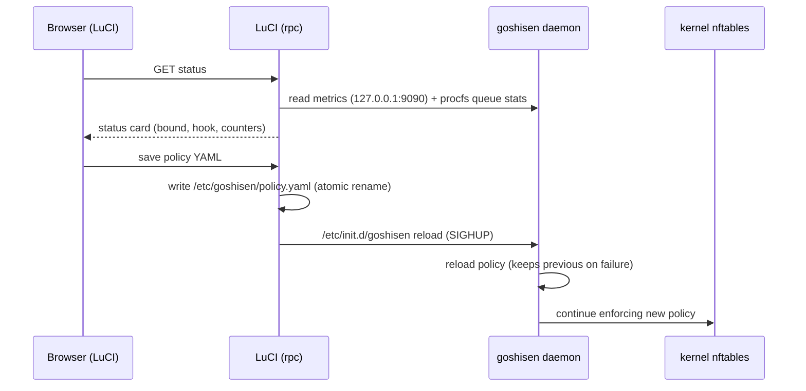

# Phase 10.11 — LuCI Architectural Proposal (draft)

Date: 2026-11-11. Status: proposal only — no LuCI code exists in this
repository (OpenWrt UI conventions live in the `luci` feed).

## Goal

Expose GoShiSen-Enforce policy status and control in the OpenWrt
LuCI web UI: a read-only status page plus a policy editor that writes
the same YAML the daemon reloads via SIGHUP. The daemon never talks to
LuCI directly; both share `/etc/goshisen/policy.yaml` and the UCI
config (`/etc/config/goshisen`).

## Boundaries

- Management traffic is outside the queue scope by construction: the
  hook is `filter forward` only, so LuCI traffic (destination to the
  router itself, input path) is never enforced. Phase 10.4 verified
  the management console stays reachable through independent paths.
- The API/metrics HTTP servers bind to `127.0.0.1` only; LuCI runs on
  the router itself, so it can read them directly. No new network
  exposure.

## Proposed LuCI modules

| Module | Type | Backing |
| --- | --- | --- |
| `luci.controller.goshisen` | controller | read `/etc/config/goshisen` via `uci`, write policy via file write |
| `luci.model.cbi.goshisen` | CBI map | UCI `goshisen.main` (queue_num, hook_scope, log_level, interface, ports) |
| `luci.view.goshisen/status.htm` | view | daemon status: process alive, queue bound (`/proc/net/netfilter/nfnetlink_queue`), hook installed (`nft list chain ip goshisen forward`), policy version, current verdict counters via `http://127.0.0.1:9090/metrics` |
| `luci.view.goshisen/policy.htm` | view | YAML textarea backed by `/etc/goshisen/policy.yaml` + "Reload" button (`/etc/init.d/goshisen reload`) |

## Flow

## Security considerations

- The policy editor is the one place that can weaken enforcement; it
  must be admin-gated (LuCI `admin` group) and must render the
  fail-closed default banner.
- Atomic write + reload ordering: write to `policy.yaml.tmp`, fsync,
  rename over `policy.yaml`, then reload. The daemon's SIGHUP path
  already compiles before replacing the active snapshot, so a bad file
  keeps the previous policy.
- Validation: reuse the daemon's `policy validate` on save (or the
  CBI `validate` hook) so syntax errors are caught before reload.

## Not in scope

- Adding LuCI to the package's `DEPENDS` (the UI is optional).
- A realtime packet viewer/sniffer.
- Multi-router fleet management.
